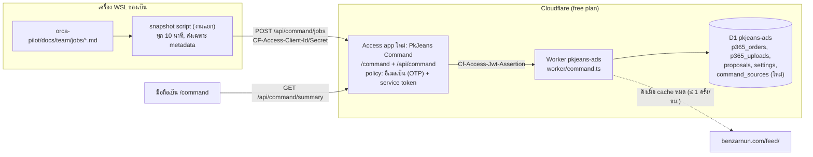
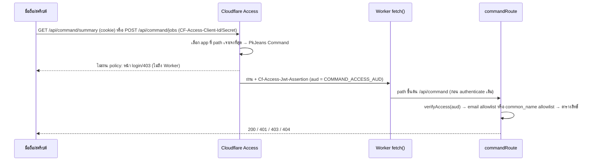

# Benz Command Center (`/command`): tech spec

- สถานะ: พร้อม build (ออกแบบ 2026-11-15 โดย wisdom ตามที่เบ๊นตัดสินไว้ 15 พ.ย. 2026)
- Branch: `feat/command-center-20261115` (worktree `.worktrees/command-center`, base `e1d28a1`)
- ขอบเขตรอบนี้: หน้าอ่านอย่างเดียว `/command` ที่เบ๊นเปิดจากมือถือ, `GET /api/command/summary`, `POST /api/command/jobs` (รับ snapshot), migration 1 ไฟล์ และ auth
- นอกขอบเขต: `/api/command/ask` (Jarvis / DNA MCP), สคริปต์ส่ง snapshot ฝั่ง orca-pilot (เป็นงานแยก ส่วนนี้ระบุแค่ contract), การสร้าง Access app จริง, เชื่อม Focus Club sheet กับ ClassRoom

---

## 1. ภาพรวม



summary **ไม่เรียก Meta API เลย** (ห้ามเรียก `loadGoal()`, `metaData()`, `metaFor()`)

## 2. การตัดสินใจหลัก

| # | ตัดสินใจ | ทางเลือกที่ไม่เลือก | ต้นทุนการย้อนกลับ |
|---|---|---|---|
| D1 | โค้ดทั้งหมดอยู่ใน `worker/command.ts` และ route `/api/command/*` **ก่อน** `authenticate()` ตัวเดิมใน `index.ts` เพราะ JWT ของ app ใหม่มี aud ไม่ตรงกับ `ACCESS_AUD` | ใส่ใน `route()` เดิม: ใช้ไม่ได้ เพราะ `authenticate()` จะตอบ 401 ก่อนถึง route | ต่ำ: ย้ายไฟล์เดียว |
| D2 | Access app ใหม่ **ตัวเดียว** มีสองปลายทาง (`/command`, `/api/command`) และสอง policy (อีเมลเบ๊น / service token) แล้ว Worker แยกสิทธิ์ตามชนิดตัวตน (ดูตาราง §5.3) | แยก app ที่สองเฉพาะ `/api/command/jobs`: ได้ด่านเพิ่มที่ edge แต่ต้องมี aud สองตัวและเบ๊นต้องตั้งค่าเพิ่ม ฝั่ง Worker ปิดอยู่แล้ว | ต่ำ: สร้าง app เพิ่มทีหลังได้ แล้วเพิ่ม aud ตัวที่สองใน allowlist |
| D3 | เก็บ snapshot งานทีมเป็น **JSON ก้อนเดียวต่อแหล่ง** ในตารางใหม่ `command_sources` (แทนที่ทั้งก้อนทุกครั้ง) ใช้ตารางเดียวกันเก็บ cache RSS และ cache YTD | (ก) แถวละ job: ต้อง DELETE+INSERT แบบ batch ซึ่ง test stand-in `sqliteD1` ยังไม่รองรับ และยังไม่มี query ไหนต้องกรองใน SQL (ข) ใช้ `meta_cache`: ไม่ต้องมี migration แต่ปนกับ cache ของ Meta และตั้งใจไว้ให้หมดอายุเร็ว | ต่ำ: ข้อมูลทั้งหมดสร้างใหม่ได้จากเครื่อง/feed, `DROP TABLE` ได้ |
| D4 | ทุก tile ใช้ซองเดียวกัน (`status`, `source`, `as_of`, `data`) โดย `data = null` เสมอเมื่อ `status` เป็น `not_connected` / `missing` / `error` **ห้ามคืน 0** | คืนตัวเลข 0 แล้วมี flag แยก: หน้าจอจะเผลอแสดง 0 ได้ | ปานกลาง: เปลี่ยน schema ต้องแก้ทั้ง client (มี `version` ไว้ให้) |
| D5 | YTD ใช้ `ytdRevenue()` + `ytdStatus()` จาก branch เป้า 100M โดยตรง และ cache ไว้ตาม "ลายเซ็นของ upload" | เรียก `loadGoal()`: เรียก Meta ทุกครั้ง ผิดข้อจำกัด | ต่ำ |

## 3. การพึ่ง branch อื่น (ต้องอ่าน)

- **YTD พึ่ง commit `7602631`** บน `feat/pk-sales-target-100m-20261115` ซึ่ง**ยังไม่ merge** และ `7602631` ต้องมี parent `ce3c318` ด้วย (commit นี้เพิ่ม `Goal.yearly_sales` และ `DEFAULT_GOAL.yearly_sales = 100_000_000`) ทั้งสองต่อจาก `e1d28a1` ซึ่งเป็น HEAD ของ branch นี้ตอนออกแบบ จึง rebase ได้ตรงๆ
- ทางเลือกตอน build (เลือกข้อแรกถ้าทำได้):
  1. ถ้าเป้า 100M merge เข้า `ads-web` แล้ว: `git rebase origin/ads-web`
  2. ถ้ายังไม่ merge: `git rebase feat/pk-sales-target-100m-20261115` แล้ว **PR ของ command center ต้อง merge หลัง PR เป้า 100M** (เขียนไว้ในคำอธิบาย PR) ถ้า branch นั้นถูก amend หรือ rebase ใหม่ ต้อง rebase ตามอีกครั้ง
  3. ถ้าถึงตอน deploy แล้วเป้า 100M ยังไม่ผ่าน: ให้ tile `pk_ytd` คืน `status: "not_connected"`, `source: "รอเป้ายอดขาย 100M/ปี merge (commit 7602631)"` โดยไม่ต้องรอ ส่วนอื่น deploy ได้
- สิ่งที่ต้องแก้หลัง rebase (เล็ก): `ytdRevenue()` ใน branch นั้นเป็นฟังก์ชันภายใน `worker/index.ts` (ไม่ได้ export) ให้**ย้ายไป `worker/p365.ts` แล้ว export** (ไฟล์นั้นมีฟังก์ชัน D1 ของ Page365 อยู่แล้ว) และให้ `index.ts` import กลับมา ห้าม import จาก `index.ts` เข้า `command.ts` (จะ import วนกัน) ห้ามเปลี่ยนตรรกะของ `ytdStatus()`
- ปีที่ใช้ = ปีของ "เมื่อวาน" เวลาไทย (`ytdStatus(yearly, bkkDate(1), days)`) เหมือนที่ `loadGoal()` ทำ เป้า = `loadSettings().goal.yearly_sales`

## 4. API

### 4.1 Endpoint

| Method | Path | ใครเรียก | หมายเหตุ |
|---|---|---|---|
| GET | `/api/command/summary` | เบ๊น (ตัวตนแบบอีเมล) | อ่านอย่างเดียว ตอบ 200 เสมอเมื่อผ่าน auth ถ้า tile ไหนพัง tile นั้นเป็น `error` |
| POST | `/api/command/jobs` | สคริปต์บนเครื่อง (ตัวตนแบบ service token) | แทนที่ snapshot ทั้งก้อน |
| (สงวนไว้) POST | `/api/command/ask` | เบ๊น | **รอบนี้ไม่ทำ** path อื่นใต้ `/api/command/` ทั้งหมดตอบ 404 |

ทุก response ใช้ `json()` เดิม (`Cache-Control: no-store`)

### 4.2 ซองของ tile (ใช้กับทุกกล่อง)

```ts
type TileStatus =
  | 'ok'             // มีข้อมูลและสด
  | 'stale'          // มีข้อมูลแต่เก่ากว่าเกณฑ์ (data ยังส่งมา หน้าจอต้องบอกว่าเก่า)
  | 'missing'        // แหล่งเชื่อมแล้ว แต่ยังไม่มีข้อมูลของช่วงนั้น (เช่น ยังไม่อัปโหลดไฟล์ Page365 เมื่อวาน)
  | 'not_connected'  // ยังไม่มีแหล่งข้อมูล
  | 'error';         // ดึงไม่สำเร็จและไม่มี cache

interface Tile<T> {
  id: string;              // คงที่ ใช้เป็น key บนหน้าจอ
  label: string;           // ภาษาไทย หนึ่งบรรทัด
  status: TileStatus;
  source: string;          // ข้อความหนึ่งบรรทัด ว่าตัวเลขมาจากไหน (หน้าจอแสดงตรงๆ ตามกฎ CLAUDE.md)
  as_of: string | null;    // ISO 8601 UTC เวลาที่ข้อมูลนี้เป็นจริง; null เฉพาะ not_connected
  data: T | null;          // null เสมอเมื่อ status เป็น missing / not_connected / error
  link?: string;           // ที่ที่เบ๊นกดไปแก้/ดูต่อ
  note?: string;           // เหตุผลสั้นๆ (เช่น ข้อความ error ที่ตัดเหลือ ≤ 200 ตัวอักษร)
}
```

กฎ `as_of`: ข้อมูลที่อัปโหลด = เวลาอัปโหลด, ข้อมูลที่ push มา = `received_at`, cache = `fetched_at`, ค่าที่คำนวณ หรือ `missing` = `generated_at` ของ response

### 4.3 Response ของ `GET /api/command/summary`

```ts
interface CommandSummary {
  version: 1;                     // เพิ่ม field ได้โดยไม่เปลี่ยนเลข; ลบ/เปลี่ยนความหมาย = version 2
  generated_at: string;           // ISO UTC
  timezone: 'Asia/Bangkok';
  today: string;                  // YYYY-MM-DD เวลาไทย (bkkDate(0))
  business: {
    source: string;               // "แต่ละช่องบอกแหล่งของตัวเอง"
    as_of: string;                // = generated_at
    tiles: [
      Tile<PkYesterday>,          // id 'pk_sales_yesterday'
      Tile<PkYtd>,                // id 'pk_ytd'
      Tile<never>,                // id 'focus_club_members'  -> not_connected เสมอในรอบนี้
      Tile<Countdown>,            // id 'focus_club_countdown'
      Tile<never>,                // id 'classroom_students'  -> not_connected เสมอในรอบนี้
      Tile<BlogLatest>,           // id 'blog_latest'
    ];
  };
  team: Tile<TeamJobs>;           // id 'team_jobs'
  todo: TodoBox;
}

interface PkYesterday { date: string; revenue: number; orders: number; units: number; uploaded_at: string }

interface PkYtd {                 // เลือก field มาจาก YtdStatus ของ goal.ts
  year: string; from: string; to: string; target: number; revenue: number; pct: number;
  pace: number; pace_uploaded: number; gap: number; uploaded_days: number; days_elapsed: number;
  projected: number | null; needed_per_day: number;
}

interface Countdown { target_at: '2026-12-01T00:00:00+07:00'; days_left: number; seconds_left: number; passed: boolean }

interface BlogLatest { posts: { title: string; url: string; published_at: string }[] }  // ≤ 3 โพสต์ ใหม่สุดก่อน

interface TeamJobs {
  generated_at: string;           // เวลาที่สคริปต์สร้าง snapshot (เวลาเครื่องเบ๊น)
  total: number;
  counts: Record<string, number>; // ทุก status ที่เจอ, ตาม string ดิบ
  active: JobMeta[];              // ดู §6.4, ≤ 20 รายการ
  more: number;                   // active ที่ตัดทิ้งเพราะเกิน 20
}
interface JobMeta { job_id: string; project: string | null; status: string; created: string | null; updated: string; from: string | null }

interface TodoBox {
  source: string;
  as_of: string;                  // = generated_at
  parts: {                        // สถานะของแต่ละแหล่ง เพื่อให้ "ไม่มีรายการ" ไม่ถูกอ่านว่า "ไม่มีงาน" เมื่อแหล่งยังไม่เชื่อม
    jobs: TileStatus;             // ตามสถานะของ team_jobs
    proposals: 'ok' | 'error';
    p365: 'ok' | 'error';
  };
  items: TodoItem[];              // เรียง: p365_missing ก่อน, proposal, แล้ว job_needs_user; ≤ 25 รายการ
  more: number;
}
interface TodoItem {
  kind: 'p365_missing' | 'proposal' | 'job_needs_user';
  ref: string;                    // date | proposal id | job_id
  title: string;                  // ภาษาไทยหนึ่งบรรทัด
  since: string | null;           // ISO: เมื่อไรที่เรื่องนี้เริ่มรอ
  link: string;                   // ต้องมีทุกรายการ ดู §6.5
}
```

### 4.4 ตัวอย่าง response

> **ตัวอย่างเท่านั้น ตัวเลข ชื่อ และ id ทุกตัวด้านล่างเป็นค่าสมมติ ไม่ใช่ข้อมูลจริง ห้ามใช้เป็น fixture ที่อ้างว่าจริง**

```json
{
  "version": 1,
  "generated_at": "2026-11-15T02:10:00.000Z",
  "timezone": "Asia/Bangkok",
  "today": "2026-11-15",
  "business": {
    "source": "แต่ละช่องบอกแหล่งของตัวเอง",
    "as_of": "2026-11-15T02:10:00.000Z",
    "tiles": [
      { "id": "pk_sales_yesterday", "label": "PK ยอดขายเมื่อวาน", "status": "ok",
        "source": "ไฟล์ Page365 ที่อัปโหลด (p365_orders) ไม่ใช้ยอด Meta",
        "as_of": "2026-11-15T01:42:11.000Z", "link": "/#sales",
        "data": { "date": "2026-11-14", "revenue": 12345, "orders": 33, "units": 51, "uploaded_at": "2026-11-15T01:42:11.000Z" } },
      { "id": "pk_ytd", "label": "PK สะสมปีเทียบเป้า 100M", "status": "ok",
        "source": "Page365 1 ม.ค.–เมื่อวาน นับเฉพาะวันที่มีไฟล์ (111/318 วัน)",
        "as_of": "2026-11-15T01:42:11.000Z", "link": "/",
        "data": { "year": "2026", "from": "2026-01-01", "to": "2026-11-14", "target": 100000000, "revenue": 1234567, "pct": 1.23,
                  "pace": 87123287.67, "pace_uploaded": 30410958.9, "gap": -85888720.67, "uploaded_days": 111, "days_elapsed": 318, "projected": 4059570.0, "needed_per_day": 2096190.6 } },
      { "id": "focus_club_members", "label": "Focus Club สมาชิก", "status": "not_connected",
        "source": "ยังไม่เชื่อม: รอ Google Sheet จาก FOCUS CLUB BOT", "as_of": null, "data": null },
      { "id": "focus_club_countdown", "label": "Focus Club เปิด 1 ธ.ค.", "status": "ok",
        "source": "คำนวณจากวันเปิด 2026-12-01 00:00 เวลาไทย", "as_of": "2026-11-15T02:10:00.000Z",
        "data": { "target_at": "2026-12-01T00:00:00+07:00", "days_left": 16, "seconds_left": 1374600, "passed": false } },
      { "id": "classroom_students", "label": "ClassRoom นักเรียน", "status": "not_connected",
        "source": "ยังไม่เชื่อม: opb-classroom ยังมีแค่ข้อมูลจำลอง", "as_of": null, "data": null },
      { "id": "blog_latest", "label": "benzarnun.com บทความล่าสุด", "status": "ok",
        "source": "RSS benzarnun.com/feed/ (cache 1 ชม.)", "as_of": "2026-11-15T01:55:00.000Z", "link": "https://benzarnun.com/",
        "data": { "posts": [ { "title": "ชื่อบทความตัวอย่าง", "url": "https://benzarnun.com/example-post/", "published_at": "2026-11-15T03:00:00.000Z" } ] } }
    ]
  },
  "team": {
    "id": "team_jobs", "label": "งานทีม", "status": "ok",
    "source": "snapshot metadata จากเครื่องเบ๊น (orca-pilot jobs) ส่งทุก 10 นาที",
    "as_of": "2026-11-15T02:05:03.000Z", "link": "/command#team",
    "data": { "generated_at": "2026-11-15T02:05:00.000Z", "total": 180,
              "counts": { "done": 66, "needs-user": 2, "sent": 1, "send-failed": 97, "cancelled": 1, "failed": 0 },
              "active": [ { "job_id": "job-20261115-090000", "project": "thai-sme-pos", "status": "needs-user",
                            "created": "2026-11-15T02:00:00.000Z", "updated": "2026-11-15T02:04:00.000Z", "from": "marcus" } ],
              "more": 0 }
  },
  "todo": {
    "source": "job needs-user จาก snapshot · ข้อเสนอที่ยังเปิดใน D1 proposals · ไฟล์ Page365 เมื่อวาน",
    "as_of": "2026-11-15T02:10:00.000Z",
    "parts": { "jobs": "ok", "proposals": "ok", "p365": "ok" },
    "items": [
      { "kind": "proposal", "ref": "prop-example-1", "title": "หยุดแคมเปญ: ชื่อแคมเปญตัวอย่าง", "since": "2026-11-15T01:00:30.000Z",
        "link": "https://discord.com/channels/<guild>/<channel>/<message>" },
      { "kind": "job_needs_user", "ref": "job-20261115-090000", "title": "งาน thai-sme-pos รอเบ๊นตัดสิน", "since": "2026-11-15T02:04:00.000Z",
        "link": "/command#job-job-20261115-090000" }
    ],
    "more": 0
  }
}
```

## 5. Auth

### 5.1 ของเดิมที่มีอยู่ (อ่านจากโค้ดแล้ว)

- `worker/auth.ts` `authenticate(req, env)`: ตรวจ `Cf-Access-Jwt-Assertion` แบบ RS256 กับ JWKS `${ACCESS_TEAM_DOMAIN}/cdn-cgi/access/certs` (cache ใน isolate 1 ชม.), ตรวจ `aud` ต้องมี `ACCESS_AUD`, `exp`, `iss === team` แล้วคืน `email ?? 'unknown'` มี `DEV_BYPASS_AUTH` ที่ใช้ได้เฉพาะ host `localhost`/`127.0.0.1`
- `index.ts` เรียก `authenticate()` กับทุก `/api/*` แล้วตรวจ `Origin` สำหรับ method ที่ไม่ใช่ GET แล้วตรวจ role (`roles.ts`)
- `/gosell` + `/assets` อยู่ใน Access app แยกที่มี aud ต่างกัน จึงเรียก `/api` ไม่ได้ ซึ่งเป็นพฤติกรรมเดียวกับที่ app ใหม่ต้องการ (JWT ของ app ใหม่ใช้กับ `/api` อื่นไม่ได้)

### 5.2 สิ่งที่ต้องเปลี่ยน (ใช้ของเดิมซ้ำ ไม่เขียนตัวตรวจใหม่)

ใน `worker/auth.ts`:

```ts
export interface AccessClaims { email?: string; common_name?: string; sub?: string; type?: string }
/** ตรวจลายเซ็น/iss/exp เหมือนเดิม และ aud ต้องมี `aud` ที่ส่งเข้ามา คืน claims หรือ null (fail closed) */
export async function verifyAccess(req: Request, env: AuthEnv, aud: string | undefined): Promise<AccessClaims | null>;
// authenticate() เดิมกลายเป็น wrapper: verifyAccess(req, env, env.ACCESS_AUD) แล้วคืน email ?? 'unknown' (พฤติกรรมเดิม 100%)
```

ใน `worker/command.ts`:

```ts
type CommandIdentity = { kind: 'user'; email: string } | { kind: 'service'; client_id: string } | { kind: 'dev' };
export async function commandIdentity(req: Request, env: CommandEnv): Promise<CommandIdentity | null>;
```

ลำดับการตรวจของ `commandIdentity`:
1. Dev bypass: เงื่อนไขเดียวกับ `authenticate()` (`DEV_BYPASS_AUTH === 'true'` และ host เป็น localhost) → `{kind:'dev'}`
2. ถ้า `ACCESS_TEAM_DOMAIN` หรือ `COMMAND_ACCESS_AUD` ว่าง → null (ปิดทุกอย่าง)
3. `verifyAccess(req, env, env.COMMAND_ACCESS_AUD)` ไม่ผ่าน → null
4. มี `email` (ไม่ว่าง): ต้องอยู่ใน `COMMAND_ALLOWED_EMAILS` (คั่นด้วย comma, เทียบแบบ trim + lowercase) → `user` ไม่อยู่ → null
5. ไม่มี `email`: **JWT ของ service token ไม่มี email** Cloudflare ใส่ `common_name` = Client ID ของ service token และ `sub` = สตริงว่าง ดังนั้นต้องได้ `sub === ''` และ `common_name` อยู่ใน `COMMAND_SERVICE_CLIENT_IDS` (comma) → `service` นอกนั้น → null
6. ห้ามใช้ fallback `'unknown'` แบบ `authenticate()`

### 5.3 ตารางสิทธิ์ (บังคับใน `commandRoute`)

| | `GET /api/command/summary` | `POST /api/command/jobs` | อื่นๆ ใต้ `/api/command` |
|---|---|---|---|
| user (อีเมลใน allowlist) | อนุญาต | 403 | 404 |
| service (client id ใน allowlist) | 403 | อนุญาต | 404 |
| dev (localhost) | อนุญาต | อนุญาต | 404 |
| null | 401 | 401 | 401 |

- method ที่ไม่ใช่ GET: ถ้ามี header `Origin` และไม่ตรงกับ `url.origin` → 403 (ลอกจาก `index.ts`) สคริปต์ไม่ส่ง Origin จึงผ่าน
- ไม่ใช้ `roles.ts` (หน้านี้มีคนเดียว ตาม allowlist)

### 5.4 จุดต่อใน `index.ts`

ใน `fetch()` วางไว้**หลัง** handler ของ `/webhook/*` และ**ก่อน** `authenticate()`:

```ts
if (url.pathname === '/api/command' || url.pathname.startsWith('/api/command/')) return commandRoute(req, env, url, ctx);
```

`commandRoute` จัดการ try/catch เอง (BadRequest → 400, อื่นๆ → 500 แบบ `index.ts`) เพิ่มชนิด env ใหม่ใน `Env` ของ `index.ts`



### 5.5 ลำดับการจับ path ของ Access (ระวัง)

app ที่มีอยู่บน `pkjeans-ads.ads-web.workers.dev`:
1. app หลัก ทั้งโดเมน (path ว่าง) aud = `ACCESS_AUD` policy PkJeans team + account members
2. app `/gosell` + `/assets` (policy PkJeans team, account members, GoSell Only)
3. app bypass `/webhook`
4. **ใหม่** app PkJeans Command: ปลายทาง `…/command` และ `…/api/command`

กฎของ Access: path ที่ไม่มี wildcard ครอบ subpath ด้วย และ app ที่ path เจาะจงกว่าชนะ โดยไม่สืบ policy จาก app ที่กว้างกว่า ผลที่ตามมา:
- ใช้ `/api/command` **ไม่ใส่ `*`** (`/api/command/*` จะไม่ครอบ `/api/command` เอง)
- คนใน PkJeans team ที่เปิด `/command` หรือ `/api/command/*` จะโดน Access บล็อกที่ edge เพราะ app ใหม่ไม่มี policy ของทีม
- **หน้า `/command` โหลด JS/CSS จาก `/assets/*` ซึ่งอยู่ใน app GoSell** เบ๊นจึงต้องผ่าน app นั้นด้วย (ตอนนี้ผ่านเพราะเป็น account member / PkJeans team) ถ้าวันหนึ่งเอาเบ๊นออกจาก policy เหล่านั้น หน้าจะขาว ต้องตรวจตอนทดสอบ
- ถ้า app ใหม่ถูกลบหรือตั้ง path ผิด คำขอจะตกไปที่ app หลัก JWT จะมี aud = `ACCESS_AUD` ซึ่งไม่ตรง `COMMAND_ACCESS_AUD` Worker จึงตอบ 401 (fail closed) แต่คนในทีมจะเห็นเปลือกหน้า `/command` ที่ว่างเปล่าได้ ไม่มีข้อมูลรั่ว
- ห้ามวาง path ของ command ไว้ใต้ `/webhook` และห้ามเพิ่ม `/api/command` ลงใน app bypass
- `run_worker_first` ใน `wrangler.jsonc` มี `/api/*` อยู่แล้ว ไม่ต้องแก้ ส่วน `/command` เป็นหน้า SPA ที่ assets เสิร์ฟ `index.html` เอง (`not_found_handling: single-page-application`)

### 5.6 Threat list

| ภัย | ป้องกันโดย |
|---|---|
| คนในทีม (PkJeans team) เปิดดูยอด/งานของเบ๊น | app แยก policy อีเมลเบ๊นคนเดียว + Worker allowlist อีเมล |
| เอา JWT ของ app หลักหรือ GoSell มาใช้กับ `/api/command` | ตรวจ aud = `COMMAND_ACCESS_AUD` |
| เอา JWT ของ command app ไปเรียก `/api` อื่น (เช่น แก้ budget) | `authenticate()` เดิมต้องการ `ACCESS_AUD` ไม่เปลี่ยน |
| Service token รั่ว | ใช้ได้แค่ `POST /jobs` (summary ตอบ 403), payload บังคับ key/regex, rotate ได้ในหน้า Zero Trust, ผลเสียสูงสุดคือรายการงานปลอม |
| เนื้อหาผลงานหลุดขึ้น cloud ผ่าน snapshot | allowlist key ต่อ job แบบเข้ม (key แปลกปลอม = 400 ทั้งก้อน) + regex ทุก field ไม่มีช่องข้อความอิสระ |
| ส่ง snapshot เก่าทับของใหม่ (replay) | `generated_at` ต้องใหม่กว่าที่เก็บไว้ ไม่งั้น 409 |
| ยิง payload ใหญ่ให้ Worker ล้ม | Access กันคนที่ไม่มี token ก่อน, Worker ตรวจ `Content-Length` และความยาวจริง ≤ 256 KB ก่อน parse |
| XSS ผ่านชื่อบทความ RSS | React แสดงเป็นข้อความเท่านั้น ห้าม `dangerouslySetInnerHTML`, `url` ต้องขึ้นต้น `https://benzarnun.com/` ไม่งั้นทิ้งโพสต์นั้น |
| CSRF | ฝั่งผู้ใช้มีแค่ GET, POST ต้องเป็นตัวตน service (ไม่ใช้ cookie) + ตรวจ Origin |
| `DEV_BYPASS_AUTH` หลุดไป production | ใช้เงื่อนไข host localhost เดิม |

## 6. แหล่งข้อมูลของแต่ละกล่อง

### 6.1 สรุปสถานะ

| Tile | แหล่ง | สถานะรอบนี้ |
|---|---|---|
| `pk_sales_yesterday` | D1 `p365_uploads` + `p365_orders` | มี |
| `pk_ytd` | `ytdRevenue()` + `ytdStatus()` | **พึ่ง branch** `feat/pk-sales-target-100m-20261115` (`ce3c318` + `7602631`) |
| `focus_club_members` | Google Sheet ของ FOCUS CLUB BOT | ยังไม่เชื่อม (`not_connected`) |
| `focus_club_countdown` | คำนวณ | มี |
| `classroom_students` | (`opb-classroom` มีแค่ mock, ห้ามใช้) | ยังไม่เชื่อม (`not_connected`) |
| `blog_latest` | RSS `https://benzarnun.com/feed/` | มี (ตรวจแล้ว 2026-11-15: ตอบ 200 `application/rss+xml`, 10 item, ~170 KB ส่วนใหญ่เป็น `content:encoded`) |
| `team_jobs` | snapshot ที่เครื่อง push มา (§7) | มีเมื่อสคริปต์ฝั่ง orca-pilot เสร็จ ก่อนหน้านั้น `not_connected` |
| `todo` | team snapshot + `proposals` + `p365_uploads` | มี (ส่วน jobs ตามสถานะ snapshot) |

### 6.2 `pk_sales_yesterday`

```sql
SELECT u.date, u.uploaded_at, COUNT(o.order_no) AS orders, COALESCE(SUM(o.total),0) AS revenue, COALESCE(SUM(o.units),0) AS units
FROM p365_uploads u LEFT JOIN p365_orders o ON o.date = u.date WHERE u.date = ?1 GROUP BY u.date
```
- `?1 = bkkDate(1)` ไม่มีแถว → `status: 'missing'`, `data: null`, `source: "ยังไม่มีไฟล์ Page365 ของ <วันที่ไทย>"`, `link: '/#sales'` **ห้ามใช้ยอด Meta แทน**
- รายได้ = `SUM(total)` ให้ตรงกับ `salesDigest()` และ `ytdRevenue()`
- ไม่ส่ง `uploaded_by` (เป็นอีเมลพนักงาน ไม่จำเป็นบนหน้านี้)

### 6.3 `pk_ytd`

- อ่าน `command_sources` แถว `ytd` ก่อน; คำนวณลายเซ็น `SELECT COUNT(*) AS n, MAX(uploaded_at) AS last FROM p365_uploads WHERE date >= ?1 AND date <= ?2` (`?1 = ปี-01-01`, `?2 = bkkDate(1)`) ถ้า `data.sig` เท่ากับ `"${to}|${n}|${last}"` ใช้ค่าที่เก็บไว้ ไม่งั้นเรียก `ytdRevenue()` + `ytdStatus()` แล้ว upsert ทับ เหตุผล: `ytdRevenue()` join ทุกออเดอร์ของปี (หลายหมื่นแถวต่อครั้ง) ซึ่งเมื่อเปิดหน้า 10 เท่าของที่คาด จะกินโควตา rows read ของ D1 free plan
- `uploaded_days === 0` → `missing`
- `source` ต้องบอกจำนวนวันที่มีไฟล์: `"Page365 1 ม.ค.–เมื่อวาน นับเฉพาะวันที่มีไฟล์ (X/Y วัน)"` (วันที่ไม่มีไฟล์นับเป็น 0 ตามตรรกะของ `ytdStatus()`)
- `as_of` = `last` (เวลาอัปโหลดล่าสุดในปี)

### 6.4 `team_jobs`

- อ่าน `command_sources` แถว `jobs` ไม่มีแถว → `not_connected`, `source: "ยังไม่เชื่อม: รอสคริปต์ส่ง snapshot จากเครื่องเบ๊น"`
- `received_at` เก่ากว่า **25 นาที** (พลาด 2 รอบ + เผื่อ) → `stale` (ยังส่ง `data`) หน้าจอแสดง "ข้อมูลเมื่อ HH:MM"
- `active` = job ที่ `status` เป็น `sent` หรือ `needs-user` (ทุกอายุ) และ `failed` / `send-failed` ที่ `updated` ภายใน 7 วัน เรียง `updated` ใหม่ก่อน ตัดที่ 20 (ตอนออกแบบมี send-failed เก่า 97 รายการ ถ้าไม่จำกัดอายุจะท่วมหน้าจอ)
- `counts` นับตาม status ดิบ (ของจริงตอนนี้มี `done`, `needs-user`, `send-failed`, `sent`, `cancelled` และ `failed` ตาม `marcus-job.sh`)

### 6.5 `todo` และลิงก์

| kind | มาจาก | title | link |
|---|---|---|---|
| `p365_missing` | ไม่มีแถว `p365_uploads` ของ `bkkDate(1)` | `ยังไม่มีไฟล์ Page365 ของ <วันที่ไทย>` | `/#sales` (แท็บยอดขายรายวันที่มีปุ่มอัปโหลด) |
| `proposal` | `SELECT id, created_at, kind, entity_name, message_id FROM proposals WHERE status = 'pending' ORDER BY created_at DESC LIMIT 11` (ใช้ index `proposals_status`) | `{pause:'หยุดแคมเปญ', move:'ย้ายสเตจ', cap:'ขยายเพดานงบ', dup:'คัดลอกแคมเปญ'}[kind] + ': ' + entity_name` | ถ้ามี `DISCORD_GUILD_ID` และ `message_id`: `https://discord.com/channels/${DISCORD_GUILD_ID}/${DISCORD_CHANNEL_ID}/${message_id}` ไม่งั้น `/#history` |
| `job_needs_user` | `status === 'needs-user'` ใน snapshot | `งาน <project ?? 'ไม่ระบุโปรเจกต์'> รอเบ๊นตัดสิน` | `/command#job-<job_id>` (เลื่อนไปที่แถวนั้นในกล่องงานทีม; เนื้องานอยู่บนเครื่อง ไม่มีบน cloud) |

- `status = 'working'` (กำลัง apply) ไม่นับเป็นงานของเบ๊น
- ข้อเสนอ non-cap หมดอายุที่ run ถัดไป (≤ 12 ชม.) cap เปิด 6 วัน จึงไม่ต้องกรองอายุเพิ่ม
- `since`: p365 = `${date}T17:00:00Z` ของวันนั้น (เที่ยงคืนเวลาไทยของวันถัดไป), proposal = `created_at`, job = `updated`
- ถ้า snapshot เป็น `not_connected` → `parts.jobs = 'not_connected'` และหน้าจอต้องเขียนว่า "ยังไม่ได้เชื่อมงานทีม" ไม่ใช่ "ไม่มีงานค้าง"

### 6.6 `focus_club_countdown`

- ค่าคงที่ในโค้ด `FOCUS_CLUB_OPEN = '2026-12-01T00:00:00+07:00'`
- `days_left = max(0, (Date.parse('2026-12-01') - Date.parse(today)) / 86400000)` โดย `today = bkkDate(0)` (วันที่ 15 พ.ย. → 16)
- `seconds_left = max(0, floor((Date.parse(FOCUS_CLUB_OPEN) - now) / 1000))`, `passed = seconds_left === 0`
- หน้าจอนับถอยหลังเองจาก `seconds_left` และ `generated_at` ไม่ต้องเรียก API ซ้ำ

### 6.7 `focus_club_members` และ `classroom_students` (จุดต่อในอนาคต)

- รอบนี้คืน `not_connected` แบบคงที่ ไม่มีการเรียกภายนอก
- จุดต่อ: ใน `command.ts` ให้แต่ละ tile เป็นฟังก์ชัน `async (ctx: SummaryCtx) => Tile<T>` ในรายการ `BUSINESS_TILES` การเชื่อมแหล่งใหม่ = เปลี่ยนฟังก์ชันของ tile นั้นตัวเดียว `id` และตำแหน่งคงเดิม
- Focus Club: **ยังไม่กำหนด schema ของ sheet** จะเขียน spec เพิ่มเมื่อ FOCUS CLUB BOT ตั้ง sheet เสร็จและบอกคอลัมน์ ข้อกำหนดล่วงหน้าเพียงข้อเดียว: id ของ sheet เก็บใน D1 `settings` เหมือน `sheet_id` (repo เป็น public) ไม่ใส่ใน `wrangler.jsonc`
- ClassRoom: ต่อเมื่อ `opb-classroom` มีข้อมูลจริง

### 6.8 `blog_latest`

- อ่าน `command_sources` แถว `rss` ถ้า `fetched_at` อายุ ≤ 60 นาที ใช้เลย; ถ้าเก่ากว่า ตอบด้วยค่าเดิม (`ok` ถ้าอายุ ≤ 24 ชม. ไม่งั้น `stale`) แล้วสั่ง refresh ใน `ctx.waitUntil` ถ้าไม่มีแถวเลย รอ fetch แบบ inline (timeout 4 วินาที) ไม่สำเร็จ → `error`
- Fetch: `GET https://benzarnun.com/feed/` header `User-Agent: pkjeans-command/1` (ชื่อกลางๆ ไม่ใส่ข้อมูลส่วนตัว), `AbortSignal.timeout(4000)`
- **อ่าน body แบบ stream แล้วหยุดเมื่อเจอ `</item>` ครบ 3 ตัว หรืออ่านเกิน 256 KB** (`reader.cancel()`) เพื่อไม่ parse ทั้ง 170 KB บน CPU 10 ms ของ free plan
- Parse ด้วย regex ต่อ `<item>…</item>`: `title`, `link`, `pubDate` รองรับทั้ง CDATA และ entity (`&amp; &lt; &gt; &quot; &#39; &#NNNN;`) ไม่ใช้ library (Worker ไม่มี DOMParser)
- เก็บเฉพาะ `{ posts: [{title, url, published_at}] }` (≤ 3) ไม่เก็บเนื้อบทความ ถ้า refresh พัง ให้คงค่าเดิมและบันทึก `error` ในแถว (แสดงใน `note`)

## 7. Snapshot contract (`POST /api/command/jobs`)

สคริปต์ฝั่ง orca-pilot เป็นงานแยก ส่วนนี้คือ contract ที่สองฝั่งต้องตรงกัน

### 7.1 Request

```
POST https://pkjeans-ads.ads-web.workers.dev/api/command/jobs
CF-Access-Client-Id: <จาก env ของสคริปต์>
CF-Access-Client-Secret: <จาก env ของสคริปต์>
Content-Type: application/json
```

```json
{
  "schema": 1,
  "source": "orca-pilot",
  "generated_at": "2026-11-15T09:05:00+07:00",
  "jobs": [
    { "job_id": "job-20261115-090000", "project": "thai-sme-pos", "status": "needs-user",
      "created": "2026-11-15T09:00:00+0700", "updated": "2026-11-15T09:04:00+0700", "from": "marcus" }
  ]
}
```
(ค่าข้างบนเป็นตัวอย่าง)

- สคริปต์อ่านจาก frontmatter ของ `docs/team/jobs/*.md` เท่านั้น (`marcus-job.sh list` ให้แค่ id/project/status จึงไม่พอ) **ห้ามส่งเนื้อหาใต้ frontmatter ห้ามส่ง `reason:`** และ key อื่นใดนอก 6 ตัวนี้
- ส่งทุก job (ตอนออกแบบมี 178 ไฟล์ ~30 KB เมื่อเป็น JSON) ทุก 10 นาที ถ้าไม่ใช่ 2xx ให้ log แล้วรอรอบถัดไป ห้าม retry ถี่

### 7.2 Validation (ใน Worker, ผิดข้อเดียว = 400 ทั้งก้อน ไม่เขียนอะไร)

| ตรวจ | กฎ |
|---|---|
| ขนาด | `Content-Length` > 262144 → 413 ก่อนอ่าน body; อ่านแล้วยาวเกิน 262144 byte → 413 |
| JSON | parse ไม่ได้ → 400 |
| key บนสุด | ตรงชุด `schema, source, generated_at, jobs` เท่านั้น |
| `schema` | `=== 1` |
| `source` | `=== 'orca-pilot'` |
| `generated_at` | ISO มี offset; ไม่ล้ำอนาคตเกิน 10 นาที; **ต้องใหม่กว่า `generated_at` ที่เก็บไว้** ไม่งั้น 409 (ไม่เขียน) |
| `jobs` | array, 0–1000 รายการ |
| key ต่อ job | อยู่ในชุด `job_id, project, status, created, updated, from` เท่านั้น ต้องมี `job_id, status, updated` |
| `job_id` | `^job-\d{8}-\d{6}$` และไม่ซ้ำกันใน payload |
| `project` | `null` หรือ `^[a-z0-9][a-z0-9._-]{0,63}$` (ไฟล์เก่า 3 ไฟล์ไม่มี project → ส่ง `null`) |
| `status` | `^[a-z][a-z-]{0,23}$` เก็บค่าดิบ (รองรับ `sent, done, failed, needs-user, send-failed, cancelled` และค่าใหม่ในอนาคต) |
| `created`, `updated` | `^\d{4}-\d{2}-\d{2}T\d{2}:\d{2}:\d{2}(Z\|[+-]\d{2}:?\d{2})$` (frontmatter จริงใช้ `+0700` ไม่มี colon) แปลงเป็น ISO UTC ก่อนเก็บ; `created` เป็น `null` ได้ |
| `from` | `null` หรือ `^[a-z0-9_-]{1,32}$` |

error body: `{ "error": "...", "errors": ["jobs[3].status: ..."] }` สูงสุด 20 ข้อ

### 7.3 Response

- 200 `{ "ok": true, "stored": <จำนวน job>, "received_at": "<ISO UTC>" }`
- 400 / 401 / 403 / 409 / 413 ตามตารางข้างบนและ §5.3

### 7.4 การเก็บ

upsert แถว `source = 'jobs'` ใน `command_sources` ด้วย statement เดียว (`data` = jobs ที่ normalize แล้ว + `generated_at`) ไม่เก็บประวัติ เขียนวันละ 144 ครั้ง ต่ำกว่าโควตาเขียนของ D1 free plan มาก

## 8. Migration

ไฟล์: `ads-web/migrations/0055_command_sources.sql` (ตอนออกแบบ `ls migrations` จบที่ `0054_feature_request_runs.sql` และไม่พบ `0055` ใน branch หรือ worktree อื่นบนเครื่อง) **ตอน build ต้องเช็กอีกครั้งทั้ง `ls migrations` หลัง rebase และ `wrangler d1 migrations list DB --remote`** ถ้าเลขชนให้ใช้เลขว่างถัดไป

```sql
-- Benz Command Center (/command): data pushed from Benz's machine (job metadata only) and small caches
-- (RSS, year-to-date). One JSON row per source, replaced whole; everything here can be rebuilt.
CREATE TABLE command_sources (
  source TEXT PRIMARY KEY,        -- 'jobs' | 'rss' | 'ytd'
  updated_at TEXT NOT NULL,       -- ISO UTC: received_at for jobs, fetched_at for caches
  generated_at TEXT,              -- jobs: the machine's generated_at (monotonic check)
  data TEXT NOT NULL,             -- JSON
  error TEXT                      -- last refresh error (rss), else NULL
);
```

- เข้ากับเวอร์ชันก่อนได้: เพิ่มตารางใหม่อย่างเดียว โค้ดเก่าไม่แตะ ถ้า deploy โค้ดก่อน migration endpoint จะตอบ 500 เฉพาะ `/api/command/*` ส่วนอื่นไม่กระทบ
- ย้อนกลับ: `DROP TABLE command_sources` ไม่มีข้อมูลที่หาใหม่ไม่ได้

## 9. Cache และข้อจำกัด (free plan)

| เรื่อง | ค่า |
|---|---|
| D1 query ต่อ summary | ~6: settings, p365 เมื่อวาน, ytd sig (+ ytdRevenue เมื่อ sig เปลี่ยน), proposals, `command_sources` (อ่าน jobs/rss/ytd ใน query เดียว `WHERE source IN (...)`), upsert ytd เมื่อเปลี่ยน |
| Subrequest ต่อ summary | 0 ปกติ; ≤ 1 RSS (เมื่อ cache เกิน 60 นาที) + ≤ 1 JWKS (cache 1 ชม. ต่อ isolate) จาก 50 ที่ free plan ให้ |
| Meta API | 0 |
| CPU | parse JSON snapshot ~30 KB + RSS แบบหยุดที่ 3 item; ห้ามโหลด `p365_orders` ทั้งแถวมาในหน่วยความจำ |
| ขนาด response | ≤ ~20 KB (active ≤ 20, todo ≤ 25, blog ≤ 3) |
| Snapshot | body ≤ 256 KB, ≤ 1000 job, stale เมื่อ > 25 นาที |
| หน้าเว็บ | โหลดตอนเปิด + ปุ่มรีเฟรช + รีเฟรชเองเมื่อแท็บกลับมา visible และผ่านมา ≥ 5 นาที ไม่มี polling ถี่ |
| ค่าใช้จ่ายเพิ่ม | 0 (Access Zero Trust Free รองรับ ≤ 50 ผู้ใช้, service token ฟรี, ไม่เพิ่ม cron: free plan มี cron ได้ 5 และใช้ไปแล้ว 4) |

โหลดจริงที่คาด (ASSUMPTION): เบ๊นเปิด ≤ 20 ครั้ง/วัน + snapshot 144 ครั้ง/วัน ออกแบบให้รับได้ 10 เท่าโดยไม่ชนโควตา (YTD cache คือส่วนที่ทำให้ได้)

## 10. หน้าเว็บ

- `web/src/CommandPage.tsx` + เพิ่ม `/^\/command\/?$/` ใน `web/src/main.tsx`
- เรียกแค่ `/api/command/summary` (ห้ามเรียก `/api/*` อื่น เพราะอยู่คนละ Access app)
- มือถือก่อน: สามกล่องเรียงลงล่าง (ธุรกิจ, วันนี้ต้องทำ, งานทีม) ทุก tile แสดง `source` หนึ่งบรรทัดใต้ตัวเลข และเวลา `as_of` แบบไทย
- `not_connected` แสดง "ยังไม่เชื่อม" สีเทา ไม่มีตัวเลข; `missing` แสดงข้อความ + ปุ่มลิงก์; `stale` แสดงตัวเลข + ป้าย "ข้อมูลเก่า"; `error` แสดง `note`
- แถวงานทีมมี `id="job-<job_id>"` ให้ลิงก์ `#job-…` เลื่อนไปถึง; กล่องงานทีมมี `id="team"`
- SiteNav: ดูคำถามค้าง Q1 (ค่าเริ่มต้นที่เสนอ: หน้านี้แสดง `<SiteNav>` เพื่อกลับไปหน้าอื่นได้ แต่**ยังไม่เพิ่ม `/command` ลง `PAGES`** เพราะคนในทีมกดแล้วจะเจอหน้าปฏิเสธของ Access)

## 11. แผนงาน (vertical slice ให้ courage หยิบทีละชิ้น)

| # | ชิ้น | เสร็จเมื่อ |
|---|---|---|
| S0 | rebase ตาม §3 + ย้าย `ytdRevenue()` ไป `p365.ts` | `npm test && npm run typecheck` ผ่าน, พฤติกรรม `/api/goal` เดิม |
| S1 | `verifyAccess()` + `commandIdentity()` + `commandRoute()` ที่ตอบ 404 สำหรับทุก path + จุดต่อใน `index.ts` | test auth §12.1 ผ่าน |
| S2 | migration 0055 + `POST /api/command/jobs` | test §12.2 ผ่าน |
| S3 | `GET /api/command/summary` ที่มี business tiles: p365 เมื่อวาน, countdown, not_connected สองตัว, YTD (หรือ `not_connected` ตาม §3 ข้อ 3) | test §12.3 ผ่าน |
| S4 | `blog_latest` + cache RSS | test §12.4 ผ่าน |
| S5 | `team` + `todo` | test §12.5 ผ่าน |
| S6 | `CommandPage.tsx` + route ใน `main.tsx` | หน้าเปิดได้บน `npm run dev` (dev bypass) ทุกสถานะแสดงถูก |
| S7 | เอกสาร: bullet หนึ่งบรรทัดใน `CLAUDE.md` + ชี้มาที่ไฟล์นี้ | ทำตอน PR |

## 12. Test plan

ใช้ `node:test` + `sqliteD1` ตามแบบไฟล์ test เดิม ไฟล์ใหม่ `worker/command.test.ts` (ส่วน auth ขยาย `worker/auth.test.ts` ที่สร้าง RSA key และ mock `fetch` ของ certs อยู่แล้ว)

### 12.1 Auth (courage เขียน, justice ตรวจว่าครบ)
1. JWT ถูกต้อง aud = command + อีเมลใน allowlist → summary 200
2. อีเมลถูกต้องแต่ไม่อยู่ใน allowlist (เช่น อีเมลทีม) → 401
3. JWT ของ app หลัก (aud = `ACCESS_AUD`) ที่ `/api/command/summary` → 401
4. JWT ของ command app ที่ `/api/me` (ผ่าน `authenticate()` เดิม) → 401 (ต้องไม่เปิดทางไป API อื่น)
5. Service JWT (`sub: ''`, ไม่มี email, `common_name` ใน allowlist) → `POST /jobs` 200, `GET /summary` 403
6. Service JWT ที่ `common_name` ไม่อยู่ใน allowlist → 401; มี email ด้วยแต่ไม่อยู่ใน allowlist → 401
7. หมดอายุ / ลายเซ็นผิด / ไม่มี header / `COMMAND_ACCESS_AUD` ว่าง → 401
8. ตัวตน user ที่ `POST /jobs` → 403; `Origin` ต่างโดเมนบน POST → 403
9. `DEV_BYPASS_AUTH=true` บน host ที่ไม่ใช่ localhost → 401
10. `/api/command/ask` และ path แปลกๆ → 404 เมื่อมีตัวตน, 401 เมื่อไม่มี
11. test เดิมของ `authenticate()` ผ่านทั้งหมดโดยไม่แก้

### 12.2 Snapshot
1. payload ถูกต้อง 178 job → 200 และอ่านกลับได้ครบ, เวลา `+0700` ถูกแปลงเป็น UTC
2. job มี key `body` หรือ `reason` → 400 และไม่มีการเขียน
3. `job_id` ผิดรูป / ซ้ำ, `status` มีช่องว่าง, `project` ตัวใหญ่ → 400
4. 1001 job → 400; body 300 KB → 413
5. `generated_at` เก่ากว่าหรือเท่ากับที่เก็บไว้ → 409 และข้อมูลเดิมไม่เปลี่ยน; ล้ำอนาคต 11 นาที → 400
6. `jobs: []` → 200 (เครื่องไม่มีงาน คือข้อมูลจริง ต่างจาก not_connected)

### 12.3 Business tiles
1. ไม่มี `p365_uploads` ของเมื่อวาน → `missing`, `data === null`, link `/#sales` และ**ไม่มีการเรียก fetch ใดๆ** (mock `fetch` ให้ throw เพื่อพิสูจน์ว่าไม่เรียก Meta)
2. มี upload แต่ 0 ออเดอร์ → `ok` revenue 0 (ไฟล์จริงที่ว่าง ต่างจากไม่มีไฟล์)
3. YTD: sig เดิม → ไม่เรียก `ytdRevenue` ซ้ำ (นับ query); อัปโหลดวันใหม่ → คำนวณใหม่; `uploaded_days 0` → `missing`
4. Countdown: now = 2026-11-15 09:10 เวลาไทย → `days_left 16`; 2026-11-30 23:59:59 ไทย → `days_left 1`, `seconds_left 1`; 2026-12-01 00:00 ไทย → `0`, `passed true`
5. `focus_club_members`, `classroom_students` → `not_connected`, `data null`, `as_of null`, มี `source`
6. ทุก tile ใน response มี `source` (string ไม่ว่าง) และมี key `as_of`; tile ที่ไม่ใช่ ok/stale มี `data === null` (test แบบวนทุก tile)
7. tile หนึ่ง throw (เช่น ตาราง proposals หาย) → tile นั้น `error`, tile อื่นยังปกติ, response 200

### 12.4 RSS
1. fixture RSS มี CDATA, `&amp;`, `&#8211;` → title ถอดถูก
2. stream ที่มี 10 item → อ่านหยุดหลัง item ที่ 3 (นับ chunk ที่อ่าน)
3. cache อายุ 30 นาที → ไม่ fetch; 2 ชม. → ตอบค่าเดิม `ok` และ refresh ผ่าน `waitUntil`; 30 ชม. + fetch พัง → `stale` + `note`
4. ไม่มี cache + fetch timeout → `error`
5. `link` ที่ไม่ใช่ `https://benzarnun.com/` → ทิ้งโพสต์นั้น

### 12.5 Team + todo
1. ไม่มี snapshot → team `not_connected`, `todo.parts.jobs = 'not_connected'`
2. snapshot อายุ 26 นาที → `stale`, data ยังมา
3. send-failed อายุ 8 วันไม่อยู่ใน `active`; needs-user อายุ 30 วันอยู่
4. proposals: `pending` เข้า, `working` / `expired` ไม่เข้า; มี/ไม่มี `DISCORD_GUILD_ID` → ลิงก์ Discord / `/#history`
5. ทุก todo item มี `link` ไม่ว่าง

### 12.6 Manual (justice ทำหลัง Benz ตั้ง Access แล้ว)
1. มือถือเบ๊น: เปิด `/command` → OTP → เห็นสามกล่อง, JS โหลดได้ (ผ่าน app `/assets`)
2. บัญชีทีม (ไม่ใช่เบ๊น) เปิด `/command` และ `/api/command/summary` → Access ปฏิเสธ
3. `curl` ไม่มี header ไป `/api/command/jobs` → Access ปฏิเสธ (ไม่ถึง Worker)
4. `curl` พร้อม service token → 200; ด้วย token เดียวกันไป `/api/command/summary` → 403
5. หน้า dashboard เดิม (`/`, `/gosell`, `/webhook/privacy`) ยังทำงานเหมือนเดิม

## 13. ชื่อ env / var (ชื่อเท่านั้น ไม่มีค่า)

Worker `pkjeans-ads`:

| ชื่อ | ชนิด | ความหมาย |
|---|---|---|
| `ACCESS_TEAM_DOMAIN` | var (มีอยู่แล้ว) | ใช้ซ้ำ ไม่ต้องแก้ |
| `COMMAND_ACCESS_AUD` | var ใน `wrangler.jsonc` (แบบเดียวกับ `ACCESS_AUD`) | Application Audience (AUD) tag ของ app PkJeans Command |
| `COMMAND_ALLOWED_EMAILS` | var (comma) | อีเมลที่เปิดหน้า/summary ได้ (เบ๊นคนเดียว) |
| `COMMAND_SERVICE_CLIENT_IDS` | secret (`wrangler secret put`) เพื่อไม่ให้อยู่ใน repo public | Client ID ของ service token ที่ส่ง snapshot ได้ (comma) |
| `DISCORD_GUILD_ID` | var, ไม่บังคับ | server id ของ Discord เพื่อทำลิงก์ไปที่ข้อความข้อเสนอ ว่าง = ลิงก์ไป `/#history` |

สคริปต์บนเครื่อง (งาน orca-pilot แยก, เก็บในไฟล์ env นอก git สิทธิ์ 600): `COMMAND_JOBS_URL`, `COMMAND_CF_ACCESS_CLIENT_ID`, `COMMAND_CF_ACCESS_CLIENT_SECRET`

## 14. สิ่งที่เบ๊นต้องทำเองใน Cloudflare dashboard (หลัง build ผ่าน review, ก่อน deploy)

1. Zero Trust → Access → Service credentials → Service Tokens: สร้าง token ชื่อ `orca-command-snapshot` (อายุ 1 ปี แล้วตั้งเตือนตัวเองต่ออายุ) เก็บ Client ID และ Client Secret ลงไฟล์ env ของสคริปต์บนเครื่อง และใส่ Client ID เป็น secret `COMMAND_SERVICE_CLIENT_IDS` (secret จะเห็นได้ครั้งเดียว)
2. สร้าง reusable policy `Command - Benz only`: Action Allow, Include Emails = อีเมลของเบ๊น อย่างเดียว ตั้ง session duration (ดู Q3)
3. สร้าง reusable policy `Command - snapshot`: Action **Service Auth**, Include Service Token = `orca-command-snapshot` (ถ้าใช้ Allow สคริปต์จะโดนเด้งไปหน้า login)
4. สร้าง Self-hosted application `PkJeans Command`: ปลายทาง `pkjeans-ads.ads-web.workers.dev/command` และ `pkjeans-ads.ads-web.workers.dev/api/command` (ไม่ใส่ `*`), แนบสอง policy ข้างบน, login method One-time PIN อย่างเดียว **ห้ามแนบ policy PkJeans team หรือ account members**
5. คัดลอก Application Audience (AUD) tag ของ app นี้ ใส่ var `COMMAND_ACCESS_AUD` และใส่อีเมลเบ๊นใน `COMMAND_ALLOWED_EMAILS`
6. ตรวจว่า app bypass `/webhook` ไม่ครอบ path ของ command และ app `/gosell` + `/assets` ยังให้เบ๊นผ่าน
7. (ไม่บังคับ) ใส่ `DISCORD_GUILD_ID`
8. รัน migration ใหม่บน remote ตามขั้นตอน deploy ปกติ แล้วทำ manual test §12.6

## 15. Risk และคำถามค้าง

ความเสี่ยง:
- **R1 (สูงสุด) branch เป้า 100M ยังไม่ merge**: ถ้าถูกแก้หรือเลิกทำ YTD ต้องเปลี่ยนตาม แผนสำรองคือ §3 ข้อ 3 (`not_connected`) จึงไม่บล็อกส่วนอื่น
- R2 path ของ Access ตั้งผิด: fail closed ฝั่ง Worker แต่หน้าจะว่าง ตรวจด้วย §12.6
- R3 เบ๊นหลุดจาก app `/assets` ในอนาคต → หน้า `/command` ขาว (พึ่ง Access app อื่นแบบซ่อนอยู่)
- R4 snapshot หยุดส่งเงียบๆ (เครื่องปิด / WSL หลับ) → `stale` หลัง 25 นาที หน้าจอต้องเห็นชัด ไม่มีการแจ้งเตือนไป Discord (ไม่เพิ่มโพสต์ตามกฎ)
- R5 YTD นับวันที่ไม่มีไฟล์เป็น 0 จึงต่ำกว่าจริงมากถ้าปีนี้อัปโหลดไม่ครบ (ไฟล์เริ่มเข้าเดือน ต.ค. 2026) `source` บอกจำนวนวันไว้ แต่เบ๊นอาจอ่านเปอร์เซ็นต์ผิดได้
- R6 `/api/command/ask` ในอนาคต: DNA MCP อยู่บนเครื่องหรือที่อื่น Worker อาจเรียกไม่ถึง ต้องออกแบบใหม่ตอนนั้น (path และตัวตน user สงวนไว้แล้ว)

คำถามที่ต้องให้เบ๊นตัดสิน:
- **Q1** กฎ CLAUDE.md บอกว่าหน้าใหม่ต้องอยู่ใน SiteNav แต่คนในทีมจะกดแล้วเจอหน้าปฏิเสธ จะ (ก) ไม่ใส่ใน nav (ที่เสนอ) (ข) ใส่ให้ทุกคนเห็น หรือ (ค) แสดงเฉพาะ owner (ต้องให้ SiteNav เรียก `/api/me`)
- **Q2** ลิงก์ของ job needs-user ตอนนี้ไปแค่แถวในหน้า `/command` เพราะเนื้องานอยู่บนเครื่อง อยากได้ field `title` สั้นๆ ใน frontmatter (ต้องแก้ orca-pilot และยอมให้ข้อความขึ้น cloud) หรือแค่ id + project พอ
- **Q3** อายุ session ของ OTP บนมือถือ: 24 ชม. (ปลอดภัยกว่า) หรือ 7 วัน (สะดวกกว่า)
- **Q4** ใส่ `DISCORD_GUILD_ID` ไหม เพื่อให้กดจากข้อเสนอไปที่ข้อความ Discord ได้ตรงๆ
- **Q5** YTD ปีนี้มีไฟล์ Page365 แค่ตั้งแต่ ต.ค. จะให้แสดง `pct` ของทั้งปีตามที่ `ytdStatus()` คำนวณ หรือเน้น `pace_uploaded` (เทียบเฉพาะวันที่มีไฟล์)
